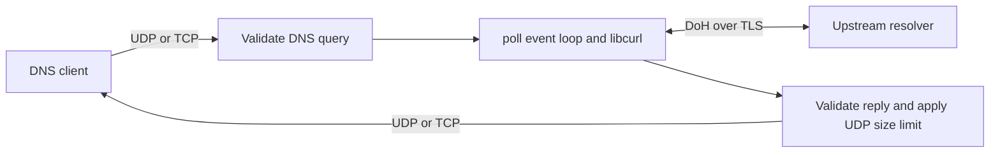
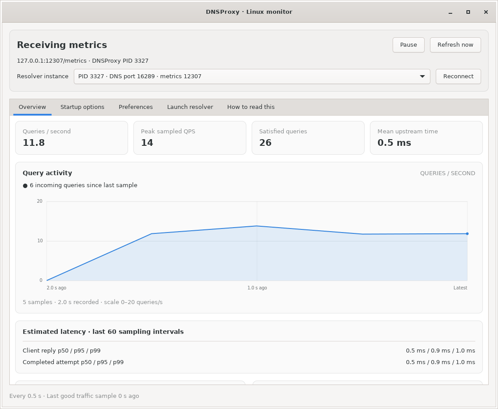

# DNSProxy — DNS over HTTPS (DoH)

<p align="center">
  <a href="https://github.com/fantuz/DNSProxy/actions/workflows/dnsp-modern.yml"></a>
  <a href="https://github.com/fantuz/DNSProxy/actions/workflows/codeql.yml"></a>
  <a href="https://github.com/fantuz/DNSProxy/releases/latest"></a>
  <a href="https://github.com/fantuz/DNSProxy/releases"></a>
  <br>
  <a href="LICENSE"></a>
  <a href="https://github.com/fantuz/DNSProxy/stargazers"></a>
  <a href="https://github.com/fantuz/DNSProxy/issues"></a>
  <a href="https://github.com/fantuz/DNSProxy/commits/master"></a>
  <br>
  <a href="packaging/README-packaging.md#packages-and-architectures"></a>
  <a href="dnsp-modern.c"></a>
  <a href="packaging/README-packaging.md#packages-and-architectures"></a>
  <br>
  <a href="#optional-upstream-http3"></a>
  <a href="https://www.rfc-editor.org/rfc/rfc8484"></a>
  <a href="SECURITY.md"></a>
</p>

DNSProxy bridges conventional **DNS clients (UDP/TCP)** to upstream
**DNS-over-HTTPS (DoH)** resolvers. The `dnsp-modern` forwarder
uses RFC 8484 `application/dns-message` POST requests, libcurl's event-driven
multi interface, TLS verification, and opportunistic HTTP/2 multiplexing.

<p align="center">
  <a href="https://github.com/fantuz/DNSProxy/releases/latest#downloads"></a>
</p>

<p align="center">
  <a href="https://github.com/fantuz/DNSProxy/releases/latest#downloads"></a>
</p>

<p align="center">
  <a href="https://github.com/fantuz/DNSProxy/releases/latest#downloads"></a>
</p>

<p align="center">
  <a href="https://github.com/fantuz/DNSProxy/releases/latest#downloads"></a>
</p>

The optional [desktop interface](docs/DESKTOP-GUI.md) displays startup settings,
query activity, latency and daemon statistics on Linux, Windows and macOS.
It includes grouped settings, diagnostics and controls for a resolver started
by the interface. Monitoring an existing service is read-only. Linux packages,
bundled Windows desktop installers and a Homebrew-based Mac launcher provide
the platform-specific distribution formats.

Release **v4.11.0-modern** contains 22 deliverables plus `SHA256SUMS`. These include Linux
daemon/GUI packages, Windows portable ZIPs, resolver/service and bundled desktop
setup EXEs, matching desktop-runtime source ZIPs, and native macOS archives with
the Homebrew GUI launcher. Each build records its source revision in addition
to the version number. See the [4.11.0 release notes](docs/releases/4.11.0.md).

[Windows setup guide](docs/WINDOWS.md)
· [macOS setup guide](docs/MACOS.md)
· [Linux installation guide](packaging/README-packaging.md)
· [Debian 13 slim container guide](docs/CONTAINERS.md)

A [Debian 13 slim OCI image](docs/CONTAINERS.md) packages the same C resolver
for Linux AMD64 and ARM64. It runs without root privileges inside the container,
supports read-only operation and publishes both UDP and TCP DNS ports. The guide
covers Docker/Podman, Compose, blocklists, health checks and release images on GHCR.

On the release page, choose **Portable ZIP** in the Windows row. Extract the
entire archive and double-click **Start-DNSProxy.cmd**. Keep `dnsp-modern.exe`,
its DLLs and the certificate bundle together. The native Windows build uses the
same C resolver as Linux; the setup guide covers service installation,
Administrator options, DNS adapter configuration and rollback.
The [standard setup EXE](docs/WINDOWS.md#standard-setup-installer) adds Windows Apps
and Start Menu entries, with optional configurable Windows service registration.
The Windows guide distinguishes resolver/service setup, bundled desktop setup,
portable ZIPs and CI artifacts.

**macOS 15+:** choose the **Intel** or **Apple Silicon** archive in the download
table, extract it into its own folder and run **Start-DNSProxy.command**. Both
architectures run natively using Apple's system libcurl; no Homebrew or Rosetta
is required. The launcher uses local port **5053**. See the macOS guide for port
53, launchd service installation, reversible DNS setup and download approval.
The distributed executables are not Developer ID signed or notarized.

This project grew out of DNS transport and privacy experiments dating to roughly
2009–2010 and work surrounding [RFC 8484](https://www.rfc-editor.org/rfc/rfc8484).
Historical project notes, experiments, and original CLI examples are preserved
in [docs/README-legacy.md](docs/README-legacy.md).

The upstream resolver handles recursion and DNSSEC validation. DNS privacy
also depends on how clients route their DNS traffic and which upstream they use.

## Rust feasibility port

A separate Rust implementation evaluates feasibility, protocol compatibility
and performance. The code and port checklist are maintained on the
[Rust feasibility branch](https://github.com/fantuz/DNSProxy/tree/poc/rust-poc).
The recorded evaluation includes C integration fixtures on Linux amd64 and
arm64, HTTP/2 and HTTP/3 fixtures, and 24,226 DNS wire comparison cases. These
results apply to the revisions identified in the evaluation records.

The [Linux performance comparison](docs/benchmarks/rust-poc-2026-11-12/README.md)
includes the method, latency, CPU/memory measurements and raw results. Below
are median queries per second from three short loopback runs with a local TLS
DoH upstream, a 1 ms upstream delay, UDP clients and the answer cache disabled.

| Upstream | Concurrent clients | C QPS | Rust QPS |
| --- | ---: | ---: | ---: |
| HTTP/2 | 1 | 683 | 693 |
| HTTP/2 | 8 | 2,755 | 2,871 |
| HTTP/2 | 32 | 4,285 | 4,412 |
| HTTP/3 | 1 | 659 | 673 |
| HTTP/3 | 8 | 3,570 | 3,450 |
| HTTP/3 | 32 | 3,451 | 3,387 |

A separate [C/Rust/Go application baseline](docs/benchmarks/linux-c-rust-go-2026-11-12/README.md)
covers UDP and persistent TCP, larger replies and one CPU per proxy, using
AdGuard dnsproxy as the Go reference.

**C is the maintained release implementation.** The reported measurements show
similar performance and slightly higher Rust memory use; they do not establish
a consistent performance advantage or predict Internet throughput. Release
packaging, service integration and protocol maintenance use the C implementation.
The Rust implementation provides a separate ownership and memory-management
model; both implementations depend on native libcurl for HTTP/TLS/QUIC.

## Supported executable

`make` builds `dnsp-modern`, the executable shipped in DNSProxy releases.
The legacy `dnsp` and `dnsp-h2` compilation recipes have been removed from the
current build. Their old target names print a retirement message, and the
historical sources and CLI instructions are archived for reference.

`dnsp-modern` supports **persistent DNS-over-TCP client sessions**, ordered
sequential/pipelined messages, and an adjustable `--tcp-idle-ms` timeout. See
[the TCP session documentation](docs/TCP_SESSIONS.md) for behavior, limits,
metrics and tests.

## Build, test and run

On Ubuntu or Debian:

```bash
sudo apt-get update
sudo apt-get install -y build-essential pkg-config libcurl4-openssl-dev python3 dnsutils
make
make modern-check
```

Tests probe IPv6 loopback over UDP and TCP at runtime. If IPv6 is disabled
(for example with `ipv6.disable=1`), IPv4 tests still run and IPv6-only cases
report a skip. The compiled resolver retains IPv6 support for deployment on
other hosts; requesting an unavailable listener with `-l ::1` remains an error.
To require IPv6 coverage, as CI does, run:

```sh
DNSP_REQUIRE_IPV6=1 make modern-check
```

CI also tests IPv4-only operation in an isolated Linux network namespace and
checks that requiring IPv6 there fails with a clear diagnostic.

With Clang and its sanitizer runtime installed, `make modern-fuzz` runs the
DNS wire and HTTP cache parser fuzzer for 30 seconds. Set `FUZZ_SECONDS` for
longer runs.

Run as an unprivileged process; UDP and TCP DNS both listen on port 5300:

```bash
./dnsp-modern -l 127.0.0.1 -p 5300 \
  -s https://cloudflare-dns.com/dns-query -m 9153
```

Do not replace your system resolver or bind port 53 until the proxy is tested.
DNS UDP/TCP listeners accept IPv4 or IPv6 addresses; repeat `-l` to enable both. Metrics always
bind **127.0.0.1** regardless of `-l`.

### Quick tests

See [deployment checks](docs/OPERATIONS.md) for protocol troubleshooting and
the coverage of each test suite.

With the proxy running, open a second terminal. Check a UDP query, a TCP query,
and an EDNS query that requests DNSSEC records.

```sh
dig @127.0.0.1 -p 5300 example.com A
dig @127.0.0.1 -p 5300 +tcp example.com AAAA
dig @127.0.0.1 -p 5300 +dnssec +bufsize=1232 example.com DNSKEY
```

**Compare the proxy with direct DoH.** Install `dnsperf` with DoH support
(`sudo apt install dnsperf` on Debian 13). The same queries go through the
local UDP listener and directly to the Cloudflare DoH upstream, at up to 20
queries per second for five seconds per run.

```sh
queries=$(mktemp)
printf '%s\n' 'example.com A' 'example.net AAAA' 'example.org MX' > "$queries"

dnsperf -m udp -s 127.0.0.1 -p 5300 -d "$queries" -l 5 -Q 20 -q 10
dnsperf -m doh -s 1.1.1.1 -p 443 -d "$queries" -l 5 -Q 20 -q 10 \
  -O doh-uri=https://cloudflare-dns.com/dns-query -O doh-method=POST

rm -f "$queries"
```

Compare completed and lost queries, response codes, and average latency.
These runs compare two end-to-end paths with different client transports and
connection setup. The rate cap makes this a smoke test. For a Google baseline,
point the proxy upstream at `https://dns.google/dns-query` and use that URI and
`-s 8.8.8.8` in the direct `dnsperf` command.

**Query a DoH URL with `curl`.** An RFC 8484 GET puts the base64url-encoded DNS
wire query in `?dns=`. This example asks Cloudflare for `example.com A`, prints
the HTTP response headers, and saves the binary answer to `doh-answer.bin`.
Google's separate JSON endpoint returns a readable answer for the same query.

```sh
curl -fsS -D - -o doh-answer.bin -H 'Accept: application/dns-message' \
  'https://cloudflare-dns.com/dns-query?dns=AAABAAABAAAAAAAAB2V4YW1wbGUDY29tAAABAAE'

curl -fsS 'https://dns.google/resolve?name=example.com&type=A'
```

Both HTTPS requests go directly to the upstream providers. To see what the
local proxy handled, run `curl -fsS http://127.0.0.1:9153/metrics` if it was
started with `-m 9153`.

### `dnsp-modern` options

Run `./dnsp-modern --help` for the options available in your build.

| Flag | Meaning | Default |
| --- | --- | --- |
| `-l IP` | DNS UDP/TCP bind address (repeatable) | `127.0.0.1` |
| `-p PORT` | DNS listener port, 1–65535 | `5300` |
| `-s URL` | Upstream DoH endpoint | `https://cloudflare-dns.com/dns-query` |
| `--backup-upstream URL` | Backup DoH endpoint for eligible transport failures | Disabled |
| `--upstream-hedge-ms MS` | Start an eligible parallel backup after this delay (0–60000); requires a backup and a delay below the total timeout | `0` (disabled) |
| `--backup-bootstrap-address IP` | Numeric address for the backup HTTPS hostname | Resolve the hostname normally |
| `-m PORT` | Loopback-only metrics port, 1–65535 and different from `-p` | Disabled for manual runs. The packaged service uses `9153`. |
| `--bootstrap-address IP` | Numeric IPv4 or unbracketed IPv6 address for an HTTPS upstream hostname | Resolve the hostname normally |
| `--edns-padding` | Pad eligible upstream HTTPS DNS queries to a multiple of 128 bytes | Disabled |
| `--ca-file PEM` | CA certificate bundle for upstream TLS verification | libcurl's default CA bundle |
| `--upstream-http MODE` | `auto` for HTTP/2 with HTTP/1.1 fallback, or `prefer-h3` for HTTP/3 with TCP fallback | `auto` |
| `--max-host-connections N` | Maximum upstream connections per host, 1–16 | `8` |
| `--tcp-max-per-source N` | Maximum concurrent DNS/TCP connections per source address, 1–128 | `32` |
| `--tcp-idle-ms MS` | How long a TCP session can wait idle for its next query, 100–600000 ms | `15000` |
| `--tcp-io-ms MS` | Separate deadlines to read a TCP request frame and write a response frame, 100–600000 ms | `15000` |
| `--doh-connect-ms MS` | Deadline for the upstream connection phase, 100–60000 ms | `1500` |
| `--doh-timeout-ms MS` | Total deadline for an upstream request, 100–60000 ms | `3000` |
| `--cache-entries N` | In-memory DNS answer cache slots, 0–1024 | `0` (disabled) |
| `--blocklist FILE` / `--allowlist FILE` | Repeatable domain/hosts policy files; allow rules override denies for the same name | Filtering disabled |
| `--block-response MODE` | `refused`, `nxdomain`, `nodata` or `null` | `refused` |
| `--blocklist-reload-ms MS` | Background file checks, 100–86400000 ms; 0 disables automatic checks | `5000` |
| `--check-blocklists` | Validate configured policy files and exit without listeners | |
| `--udp-reply-max BYTES` | Maximum UDP reply size with EDNS, 512–4096 | `1232` |
| `-V`, `--version` | Print DNSProxy and libcurl versions, the TLS backend, and HTTP capabilities | |
| `-h`, `--help` | Print options and exit | |

Unknown options or invalid numeric options exit with status 2. Remote upstreams
must use HTTPS. Plaintext HTTP is limited to the `127.0.0.1` testing endpoint
and bypasses proxy environment settings. HTTPS upstreams use TLS certificate
and hostname verification, and redirects are disabled.

If the host uses DNSProxy as its system resolver, configure an upstream IP to
bootstrap the HTTPS connection without consulting the system resolver:

```sh
./dnsp-modern -s https://cloudflare-dns.com/dns-query --bootstrap-address 1.1.1.1
```

`--bootstrap-address IP` accepts one numeric IPv4 or unbracketed IPv6 address
for an HTTPS upstream hostname. It connects directly to that address, bypassing
proxy environment settings, while keeping the URL hostname for TLS and HTTP.
Choose an address served by your DoH provider and update it if the provider
changes addresses.

#### Optional upstream HTTP/3

```sh
./dnsp-modern --upstream-http=prefer-h3 -s https://cloudflare-dns.com/dns-query -m 9153
dig @127.0.0.1 -p 5300 example.com A
curl -fsS http://127.0.0.1:9153/metrics | grep dnsp_upstream_http_responses_total
```

`prefer-h3` requires an HTTPS upstream and a linked libcurl 7.88.0 or newer
with HTTP/3 support.
Debian 13 supplies a compatible libcurl. An unsupported explicit preference
exits at startup with status 2. When QUIC connection setup fails or is slow,
libcurl can negotiate HTTP/2 or HTTP/1.1 over TCP within the same upstream
deadlines. A fallback connection can be reused for subsequent queries.
libcurl uses TCP when a forward proxy is in use. Direct QUIC requires UDP
reachability to the upstream HTTPS port, usually 443.

Startup and `SIGUSR1` reports show the requested `http_preference`.
`dnsp_upstream_http_responses_total{version="3"}` counts negotiated HTTP/3
responses. [libcurl HTTP version selection](https://curl.se/libcurl/c/CURLOPT_HTTP_VERSION.html)

The upstream connection deadline covers name resolution and handshakes for a
new connection. The total deadline includes time queued by libcurl. Set
`--doh-connect-ms` no higher than `--doh-timeout-ms`. This example allows a
slower connection and more time for the reply.

```sh
./dnsp-modern --doh-connect-ms 2500 --doh-timeout-ms 5000
```

With a backup configured, eligible queries reserve half of the available
deadline for retry. Optional `--upstream-hedge-ms 150` starts a delayed parallel
backup for a slow primary; the first validated DNS reply wins and cancels the
other attempt. Both attempts share the original deadline. TLS authentication
of the primary completes before a parallel backup starts. This can disclose
more queries to the backup; use resolvers with equivalent DNS views and policies. See [upstream failover](docs/UPSTREAM_FAILOVER.md) for
eligible requests, failure policy, and per-endpoint metrics.

Check the active deadlines in the [on-demand status report](#on-demand-status-report).
For systemd overrides, see the [packaging guide](packaging/README-packaging.md).

The bundled [HTTP/2 benchmark](bench/README.md) measures concurrent streams,
QPS, latency percentiles, CPU and RSS on local test servers.

## Architecture and protocol scope

With `--edns-padding`, the proxy appends zero-filled EDNS Padding to unsigned
queries with a final EDNS(0) OPT record. Queries that already carry Padding,
use message signatures, lack a suitable OPT record, or would exceed the DNS
message limit pass through as sent. The proxy removes response padding from an
unsigned final EDNS(0) OPT when it added the request padding itself.
[RFC 8467](https://www.rfc-editor.org/rfc/rfc8467.html#section-4.1)



- Binary DNS wire packets arrive over UDP or framed DNS-over-TCP.
- DoH requests use a persistent libcurl multi manager; libcurl socket and timer
  callbacks are integrated into the main `poll()` event loop.
- The default HTTPS preference is HTTP/2 with HTTP/1.1 fallback. Operators can
  opt in to HTTP/3 where the linked libcurl and upstream support it. The HTTP
  version counters report the protocol used for each response.
- Outstanding upstream requests, TCP client slots, and response sizes are
  bounded; upstream requests have connection and overall timeouts.
- Incoming DNS packets and upstream HTTP status, `Content-Type`, transaction ID,
  question and DNS record boundaries are validated before replies are sent.
- The IPv4 UDP listener accepts up to 65,507 bytes per datagram. TCP and the
  DoH wire body accept DNS messages up to 65,535 bytes. DNS/TCP carries a
  two-byte length prefix outside that limit. Name compression pointer walks
  are bounded across each message. Compressed names cannot read the TTL bytes
  the proxy may age. The UDP receive loop yields after 32 datagrams or after
  reaching 64 KiB of wire data, whichever comes first.
- On an IPv4 wildcard bind, Linux packet information preserves the local
  address for UDP replies, including cache hits and coalesced replies.
- UDP replies are limited to 512 bytes without EDNS. With EDNS, the client's
  advertised size is clamped between 512 and `--udp-reply-max` (default 1232).
  Larger replies use `TC=1` for TCP
  retry. The input and reply limits are independent.
- DoH transports arbitrary QTYPEs and QCLASSes in standard DNS QUERY messages.
  Unknown record types and well-framed EDNS options are relayed as opaque
  data. The upstream resolver determines the actual answer and supported EDNS
  versions. DNSSEC records and flags pass through. The proxy keeps the original
  DNS transaction ID and supports questionless exchanges such as DNS Cookie
  negotiation when the upstream implements them.
- Query format errors receive `FORMERR` when the DNS header is available.
  AXFR, IXFR and unsupported opcodes receive `NOTIMP`. This service forwards
  single DNS exchanges. The upstream handles DNSSEC validation.
- A persistent TCP session accepts pipelined queries and sends replies in
  order, with one upstream request in flight per session. DNS/TCP has 128
  connection slots. Set `--tcp-max-per-source` for clients sharing an address.
  With 96 or more open connections, the idle timeout is capped at 3 seconds.
  Partial frame reads and response writes keep their separate I/O deadlines.

The client-to-proxy DNS leg is not encrypted merely because the upstream DoH
connection is encrypted. Do not bind the proxy to an untrusted interface.

Forwarded unsigned DNS replies have their record TTLs reduced by the DoH
`Age` header, including when the answer cache is disabled. OPT fields and
message signatures are preserved.

## Optional domain filtering

Optional domain/hosts blocklists and allowlists are available with `--blocklist`
and `--allowlist`. Filtering covers UDP/TCP and all supported IN/ANY-class query types,
checks reachable aliases, and reloads lists in the background while keeping the
previous rules on failure. See [domain filtering and safe updates](docs/BLOCKLISTS.md)
for reply modes, DNSSEC behaviour, packaged-service setup and CI performance comparisons.

## Optional in-memory answer cache


```sh
./dnsp-modern --cache-entries 512 -m 9153
dig @127.0.0.1 -p 5300 +noedns example.com A
dig @127.0.0.1 -p 5300 +noedns example.com A
curl -fsS http://127.0.0.1:9153/metrics | grep '^dnsp_cache_'
```

The cache is disabled by default. It reuses complete positive IN A, AAAA,
SVCB and HTTPS answers, including CNAME chains, for matching UDP and TCP
queries. The wire query must match byte for byte apart from the transaction
ID. An empty EDNS(0) OPT is eligible. EDNS options, DNSSEC DO/CD queries
and truncated replies use the upstream path.

For these four query types, the cache also accepts direct NXDOMAIN and NODATA
replies with a single IN SOA for the queried name or an enclosing zone. The
lower of the SOA TTL and MINIMUM determines the negative lifetime, subject to
HTTP freshness limits and the local retention cap. Reuse requires the same
question type. Referrals, negative replies with aliases, and negative replies without
a suitable SOA remain on the forwarding path.

Entries expire at the earliest answer TTL or upstream HTTP freshness limit,
with a local retention cap of one hour. Cache hits restore the caller's ID and
age each answer TTL, including the HTTP `Age` of the original DoH response.
Zero-TTL answers and HTTP responses with reuse restrictions such as `no-store`,
`no-cache`, or `private` skip storage. `Vary: Accept` is eligible because the
proxy always sends the same upstream `Accept` value. Other `Vary` values skip
storage. The cache accepts numeric
`max-age` and `s-maxage` and conservatively skips unfamiliar cache directives.
Expired entries are never served, even during upstream failure.
[RFC 8484 cache interaction](https://www.rfc-editor.org/rfc/rfc8484.html#section-5.1)

Storage is allocated once, with at most 4 KiB of reply data per slot plus
metadata. A hash collision replaces the previous entry in that slot. Restarting
the process clears the cache. Hit and miss counts are also in the `SIGUSR1`
status report. Misses count eligible queries that did not get a cached reply.

## Metrics and observability

### On-demand status report

Send `SIGUSR1` to a running `dnsp-modern` process built from this source. For a
manual run, use `kill -USR1 "$pid"` with the proxy's PID and read stderr. For a
systemd installation, run the following commands.

```sh
sudo systemctl kill --kill-who=main --signal=SIGUSR1 dnsp-modern
sudo journalctl -u dnsp-modern -n 20 --grep='event=stats'
```

The event loop logs one `event=stats` line with uptime, listener and timeout
settings, queries by transport, upstream outcomes, truncation, connection
reuse and current load. It works with metrics disabled. Signals sent in quick
succession may produce one report. The report omits the upstream URL, query
names and client addresses.

`queries_satisfied` counts complete upstream `NOERROR` and `NXDOMAIN` replies
written to the client socket, including valid negative answers. Truncation
and error replies are excluded. `upstream_ok` counts validated DNS messages
from the upstream, including valid DNS error responses. For UDP, a successful
socket write means the kernel accepted the datagram for sending. Counters are
cumulative since start.

### Logs and Prometheus metrics

The proxy writes startup and failure diagnostics to stderr. For a systemd
installation, read them with `journalctl -u dnsp-modern`. Warnings include an
event name, client transport, upstream role, and numeric libcurl, HTTP and
proxy CONNECT codes when available. Each warning category emits at most once
per upstream role every ten seconds. The next warning reports how many messages
it suppressed. Startup logs identify the build-time and runtime libcurl versions.
The log omits the upstream URL, DNS questions, payloads, and client addresses.

Matching in-flight UDP A and AAAA queries without EDNS can share one upstream
transfer. Each reply uses the caller's transaction ID, and repeated datagrams
with the same client endpoint, local destination and ID use one reply slot.
Each transfer can serve the original request plus eight waiters. They share the
original upstream deadline.
When the returned HTTP response forbids reuse, joined clients get separate
upstream attempts within their original time budgets.

When all upstream slots are in use, queries that need a new transfer receive
`SERVFAIL`.
`dnsp_overload_total` includes these replies and local request setup failures.

The packaged systemd unit enables HTTP metrics at
`http://127.0.0.1:9153/metrics`; manual runs enable metrics only with `-m`.
Useful Prometheus-compatible series:

| Metric | Meaning |
| --- | --- |
| `dnsp_queries_total{transport="udp"}` / `{transport="tcp"}` | Submitted queries by protocol |
| `dnsp_queries_satisfied_total` | Complete `NOERROR` and `NXDOMAIN` replies written to client sockets |
| `dnsp_queries_inflight` | Active upstream requests |
| `dnsp_tcp_connections_rejected_total{reason="source_limit"}` / `{reason="capacity"}` | DNS/TCP connections closed at admission due to the per-source limit or a full table |
| `dnsp_udp_queries_coalesced_total` | UDP datagrams that joined an active transfer, including retransmits |
| `dnsp_upstream_requests_total` | Submitted upstream DoH requests |
| `dnsp_upstream_success_total`, `dnsp_upstream_failures_total`, `dnsp_upstream_timeouts_total` | Completion and errors |
| `dnsp_invalid_queries_total`, `dnsp_invalid_responses_total`, `dnsp_overload_total` | Validation/capacity events |
| `dnsp_truncated_responses_total` | Truncated UDP answers |
| `dnsp_upstream_http_responses_total{version="1"}`, `{version="2"}`, `{version="3"}` | Responses by negotiated upstream HTTP version |
| `dnsp_upstream_new_connections_total`, `dnsp_upstream_reused_requests_total` | libcurl connection activity |
| `dnsp_upstream_easy_handles_reused_total` | Transfers that took a reset easy handle from the idle pool |
| `dnsp_upstream_duration_seconds_bucket`, `_sum`, `_count` | Bounded completed-attempt latency histogram; cancelled attempts excluded |
| `dnsp_client_duration_seconds_bucket`, `_sum`, `_count` | Complete client reply latency by `transport="udp"` or `"tcp"`, including cache and policy replies |
| `dnsp_build_info` | Running daemon/libcurl version and built HTTP/2/3 capabilities |
| `dnsp_upstream_hedges_started_total`, `_suppressed_total`, `_cancelled_total` | Parallel backup launches, capacity/setup suppression and cancelled losing attempts |
| `dnsp_upstream_hedge_wins_total{role="primary"}`, `{role="backup"}` | Validated replies that win a launched race |
| `dnsp_upstream_hedges_inflight` | Extra parallel attempts; `dnsp_queries_inflight` counts logical queries |
| `dnsp_upstream_phase_duration_seconds_sum`, `dnsp_upstream_phase_duration_seconds_count` | Queue wait (libcurl 8.6+), new TLS handshake, and time from transfer-ready to first byte, selected by `phase` |
| `dnsp_curl_socket_callbacks_total`, `dnsp_curl_timer_callbacks_total` | Event-loop activity |

Metrics reset when the process restarts. They do not expose query names or
client addresses. The HTTP version and connection reuse counters **do not
measure simultaneous HTTP/2 streams**; use the bundled benchmark for
that measurement.

### Optional Linux desktop monitor

The Linux package provides the shared GTK 4 desktop interface. It displays live
`dnsp-modern` statistics and retains the last valid values during slow or failed
scrapes, with a **No fresh data** indication. The overview includes query-rate
and latency histories, sampled QPS/load peaks, lifetime latency maxima, upstream
HTTP/1/2/3 counters, cache and filtering statistics, and available process CPU,
memory and uptime measurements. The instance picker selects among readable
resolvers; service state is read separately from the service manager.

Startup settings distinguish explicit arguments from defaults when the process
command line is readable. Grouped options configure a separate resolver owned
by the GUI; diagnostics show its bounded recent output. Existing services and
system DNS retain their independent configuration. The GUI runs as an ordinary
desktop user and reads the loopback metrics endpoint. The C resolver has no
dependency on the graphical interface.



The screenshot records the Linux monitor in release 4.9.0, using real local DNS
queries in CI. The shared desktop guide describes the current interface.
The following source example displays explicitly labelled synthetic data:

```sh
sudo apt install python3-gi python3-gi-cairo gir1.2-gtk-4.0
/usr/bin/python3 tools/linux-gui/dnsp-gui.py --demo
```

For live traffic, enable metrics when starting the resolver, for example:

```sh
./dnsp-modern -l 127.0.0.1 -p 5300 -m 9153
```

Then open the monitor in another terminal:

```sh
/usr/bin/python3 tools/linux-gui/dnsp-gui.py
```

It auto-detects a single readable resolver. Choose among multiple instances
in the window or use `--pid PID`. Use `--metrics-port 9153` for traffic-only monitoring when
process details are inaccessible. The packaged systemd service already enables
metrics on port `9153`.

**Pause** switches to on-demand sampling with **Refresh now**. Incoming-query
activity appears on the next sample. Closing the window leaves an externally
started daemon or service running; it stops a resolver started by that window.
Optional `dnsp-modern-gui` DEB (`all`) and RPM (`noarch`) packages add a desktop
launcher and `dnsp-gui` command. They work on Linux x86-64 and ARM64; install the
package for your distribution alongside the daemon. These packages are available
from v4.6.0 onward. GTK dependencies
belong only to the optional GUI package. See the [installation guide](packaging/README-packaging.md#optional-linux-desktop-package).
X11 is tested in GitHub CI on Linux x86-64 and ARM64; native Wayland operation is
outside the automated desktop qualification. See the [Linux GUI guide](docs/LINUX-GUI.md) for the startup-options
preview, counter definitions, polling limits and troubleshooting.

## Debian packaging and systemd

```bash
sudo apt-get install -y dpkg-dev
sh scripts/build-deb.sh
# The default version comes from VERSION.
sudo apt install "./dist/dnsp-modern_$(cat VERSION)_$(dpkg --print-architecture).deb"
```

A different version can be supplied for packaging:

```bash
VERSION=0.2.1 sh scripts/build-deb.sh
sudo apt install ./dist/dnsp-modern_0.2.1_$(dpkg --print-architecture).deb
```

The package installs `/usr/bin/dnsp-modern` and a systemd service, **disabled
and stopped** by default. It does not edit `/etc/resolv.conf` or take port 53.
The packaged service runs under a restricted dynamic user and forwards to the
Cloudflare DoH endpoint on `127.0.0.1:5300` with metrics on `127.0.0.1:9153`.

```bash
sudo systemctl enable --now dnsp-modern
systemctl status dnsp-modern
journalctl -u dnsp-modern -f
```

Change settings with `sudo systemctl edit dnsp-modern`, clearing `ExecStart=`
before supplying a replacement. See
[packaging/README-packaging.md](packaging/README-packaging.md) for details.

## Packages and releases

The [4.11.0 release notes](docs/releases/4.11.0.md) cover DNS outcome metrics,
HTTPS/SVCB and negative caching, desktop settings validation, Windows service
reconfiguration and measured Apple Silicon build times.
The [4.10.0 release notes](docs/releases/4.10.0.md) describe the shared desktop
interface, native Windows GUI installers and Homebrew Mac launcher.
See the [4.9.0 release notes](docs/releases/4.9.0.md) for faster desktop
sampling, timestamped charts, balanced information panels and CI build reuse.
The [4.8.0 release notes](docs/releases/4.8.0.md) cover stable desktop refresh,
statistics, monitoring preferences and resolver launch controls. The
[4.7.0 release notes](docs/releases/4.7.0.md) cover Debian 13 slim container
images, tested image publication and upgrade guidance. The
[4.6.0 release notes](docs/releases/4.6.0.md) describe desktop packages,
latency reporting and delayed parallel upstream requests.

GitHub Actions builds DEBs for Debian 13 and Ubuntu 22.04/24.04, and RPMs for
Rocky Linux 9. Each distribution has native x86-64 and ARM64 builds. Download
the matching package and `SHA256SUMS` from
[GitHub Releases](https://github.com/fantuz/DNSProxy/releases).
Windows builds offer native AMD64 and Windows 11 ARM64 portable ZIPs from
the same C resolver. Both architectures are available from v4.5.0 onward;
resolver/service and bundled desktop setup EXEs are available from v4.10.0 onward. See the
[Windows guide](docs/WINDOWS.md) for architecture selection, launch and DNS setup.

Set the next version in `VERSION` and merge to `master` to publish once the
Linux package matrix, sanitizer job, native Windows/macOS tests and both
Windows desktop installer acceptance jobs pass.
The publishing workflow requires eight Linux daemon packages, four architecture-independent
GUI packages, two Windows ZIPs, two service setup EXEs, two desktop setup EXEs,
two matching desktop-runtime source ZIPs and two macOS archives,
all covered by `SHA256SUMS`. See the
[packaging guide](packaging/README-packaging.md) for installation, local
builds, and manual release recovery.

## IPv4 and IPv6 listeners

The same C resolver supports native UDP/TCP listeners on Windows and Linux.
Repeat `-l` for up to eight numeric addresses, sharing one DNS port and cache:

```sh
./dnsp-modern -l 127.0.0.1 -l ::1 -p 5300 --bootstrap-address 1.1.1.1
```

Omitting `-l` preserves the IPv4 loopback default. IPv6 sockets explicitly use
`IPV6_V6ONLY=1`; use both addresses to serve both families. An explicitly
requested listener must bind successfully, otherwise startup closes all listeners
and fails. Wildcards (`0.0.0.0` / `::`) expose the selected family on all interfaces
and require appropriate network access controls. Link-local IPv6 addresses need
an interface scope, for example `fe80::1%eth0` or a numeric interface index.
UDP replies preserve the receiving local address and IPv6 interface scope.
Non-jumbo UDP input limits are 65,507 bytes on IPv4 and 65,527 bytes on IPv6.
TCP source limits distinguish address families and scoped IPv6 addresses.
Metrics remain on IPv4 loopback; DNS records and upstream transports are
independent of the listener family.

## Desktop validation scope

Automated desktop tests cover X11 on Linux and native windows on Windows and
macOS. Native Wayland, mixed-DPI and multi-monitor operation require separate
qualification. Functional tests establish bounded sampling and history storage;
they do not establish a general GUI-overhead bound for every workload.

## Contributing

See the [C maintenance guide](docs/C_MAINTENANCE.md) for repository layout
criteria, C review checks, and commands to run before opening a PR.
See the [security policy](SECURITY.md) for private vulnerability reporting.

