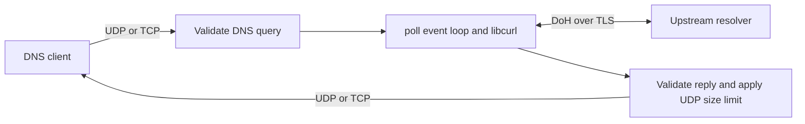

# DNSProxy — DNS over HTTPS (DoH)

[](https://github.com/fantuz/DNSProxy/actions/workflows/dnsp-modern.yml)
[](https://github.com/fantuz/DNSProxy/actions/workflows/codeql.yml)
[](https://github.com/fantuz/DNSProxy/actions/workflows/dnsp-modern-benchmark.yml)
[](https://github.com/fantuz/DNSProxy/releases)
[](https://github.com/fantuz/DNSProxy/releases)
[](LICENSE)
[](https://www.rfc-editor.org/rfc/rfc8484)

DNSProxy bridges conventional **DNS clients (UDP/TCP)** to upstream
**DNS-over-HTTPS (DoH)** resolvers. The `dnsp-modern` forwarder
uses RFC 8484 `application/dns-message` POST requests, libcurl's event-driven
multi interface, TLS verification, and opportunistic HTTP/2 multiplexing.

This project grew out of DNS transport and privacy experiments dating to roughly
2009–2010 and work surrounding [RFC 8484](https://www.rfc-editor.org/rfc/rfc8484).
Historical project notes, experiments, and original CLI examples are preserved
in [docs/README-legacy.md](docs/README-legacy.md). **Those legacy instructions
do not describe `dnsp-modern`.**

The upstream resolver handles recursion and DNSSEC validation. DNS privacy
also depends on how clients route their DNS traffic and which upstream they use.

## Which executable?

| Executable | Role | Build | Status |
| --- | --- | --- | --- |
| `dnsp-modern` | Event-driven RFC 8484 DoH forwarder | `make` | Current implementation |
| `dnsp-h2` | Historical DoH prototype with different features and CLI | `make dnsp-h2` | Legacy, requires a compatible toolchain |
| `dnsp` | Pre-standardization HTTP/DNS experiment | Historical source in `dnsp.c` | Retired build target |

The default build produces `dnsp-modern`. The old implementations use their own
CLI flags and include features such as disk caching and custom TTL rewriting.
See the [historical notes](docs/README-legacy.md) for their behavior.

`dnsp-modern` now supports **persistent DNS-over-TCP client sessions**, ordered
sequential/pipelined messages, and an adjustable `--tcp-idle-ms` timeout. See
[the TCP session documentation](docs/TCP_SESSIONS.md) for behavior, limits,
metrics and tests.

## Build, test and run

On Ubuntu or Debian:

```bash
sudo apt-get update
sudo apt-get install -y build-essential pkg-config libcurl4-openssl-dev python3 dnsutils
make
make modern-check
```

Run as an unprivileged process; UDP and TCP DNS both listen on port 5300:

```bash
./dnsp-modern -l 127.0.0.1 -p 5300 \
  -s https://cloudflare-dns.com/dns-query -m 9153
```

Do not replace your system resolver or bind port 53 until the proxy is tested.
The DNS listeners are IPv4; `-l` expects an IPv4 bind address. Metrics always
bind **127.0.0.1** regardless of `-l`.

### Quick tests

With the proxy running, open a second terminal. Check a UDP query, a TCP query,
and an EDNS query that requests DNSSEC records.

```sh
dig @127.0.0.1 -p 5300 example.com A
dig @127.0.0.1 -p 5300 +tcp example.com AAAA
dig @127.0.0.1 -p 5300 +dnssec +bufsize=1232 example.com DNSKEY
```

**Compare the proxy with direct DoH.** Install `dnsperf` with DoH support
(`sudo apt install dnsperf` on Debian 13). The same queries go through the
local UDP listener and directly to the Cloudflare DoH upstream, at up to 20
queries per second for five seconds per run.

```sh
queries=$(mktemp)
printf '%s\n' 'example.com A' 'example.net AAAA' 'example.org MX' > "$queries"

dnsperf -m udp -s 127.0.0.1 -p 5300 -d "$queries" -l 5 -Q 20 -q 10
dnsperf -m doh -s 1.1.1.1 -p 443 -d "$queries" -l 5 -Q 20 -q 10 \
  -O doh-uri=https://cloudflare-dns.com/dns-query -O doh-method=POST

rm -f "$queries"
```

Compare completed and lost queries, response codes, and average latency.
These runs compare two end-to-end paths with different client transports and
connection setup. The rate cap makes this a smoke test. For a Google baseline,
point the proxy upstream at `https://dns.google/dns-query` and use that URI and
`-s 8.8.8.8` in the direct `dnsperf` command.

**Query a DoH URL with `curl`.** An RFC 8484 GET puts the base64url-encoded DNS
wire query in `?dns=`. This example asks Cloudflare for `example.com A`, prints
the HTTP response headers, and saves the binary answer to `doh-answer.bin`.
Google's separate JSON endpoint returns a readable answer for the same query.

```sh
curl -fsS -D - -o doh-answer.bin -H 'Accept: application/dns-message' \
  'https://cloudflare-dns.com/dns-query?dns=AAABAAABAAAAAAAAB2V4YW1wbGUDY29tAAABAAE'

curl -fsS 'https://dns.google/resolve?name=example.com&type=A'
```

Both HTTPS requests go directly to the upstream providers. To see what the
local proxy handled, run `curl -fsS http://127.0.0.1:9153/metrics` if it was
started with `-m 9153`.

### `dnsp-modern` options

| Flag | Meaning | Default |
| --- | --- | --- |
| `-l IPv4` | DNS UDP/TCP bind address | `127.0.0.1` |
| `-p PORT` | DNS listener port, 1–65535 | `5300` |
| `-s URL` | Upstream DoH endpoint | `https://cloudflare-dns.com/dns-query` |
| `-m PORT` | Loopback-only metrics listener port; must differ from `-p` | Disabled for manual runs |

Unknown options or invalid ports exit with status 2. Remote upstreams must use
HTTPS; plaintext HTTP is permitted **only for a 127.0.0.1 local testing host**.
The loopback HTTP test endpoint is contacted directly. HTTPS upstreams use TLS
certificate and hostname verification, and redirects are disabled.

If the host uses DNSProxy as its system resolver, configure an upstream IP to
bootstrap the HTTPS connection without consulting the system resolver:

```sh
./dnsp-modern -s https://cloudflare-dns.com/dns-query --bootstrap-address 1.1.1.1
```

`--bootstrap-address IP` accepts one numeric IPv4 or unbracketed IPv6 address
for an HTTPS upstream hostname. It connects directly to that address, bypassing
proxy environment settings, while keeping the URL hostname for TLS and HTTP.
Choose an address served by your DoH provider and update it if the provider
changes addresses.

The bundled [HTTP/2 benchmark](bench/README.md) measures concurrent streams,
QPS, latency percentiles, CPU and RSS on local test servers. Use
`--max-host-connections N` to tune the upstream connection cap (1–16, default 8)
and `--ca-file PATH` to use a custom TLS CA bundle.

## Architecture and protocol scope



- Binary DNS wire packets arrive over UDP or framed DNS-over-TCP.
- DoH requests use a persistent libcurl multi manager; libcurl socket and timer
  callbacks are integrated into the main `poll()` event loop.
- HTTP/2 is requested over TLS if negotiated; HTTP/1.1 can be used as fallback.
  **RFC 8484 does not require HTTP/2.** Connection reuse counters do not prove
  HTTP/2 multiplexing; benchmark actual simultaneous streams.
- Outstanding upstream requests, TCP client slots, and response sizes are
  bounded; upstream requests have connection and overall timeouts.
- Incoming DNS packets and upstream HTTP status, `Content-Type`, transaction ID,
  question and DNS record boundaries are validated before replies are sent.
- The IPv4 UDP listener accepts up to 65,507 bytes per datagram. TCP and the
  DoH wire body accept DNS messages up to 65,535 bytes. DNS/TCP carries a
  two-byte length prefix outside that limit.
- UDP replies are limited to 512 bytes without EDNS. With EDNS, the client's
  advertised size is clamped to 512–4096. Larger replies use `TC=1` for TCP
  retry. The input and reply limits are independent.
- DoH transports arbitrary QTYPEs and QCLASSes in standard DNS QUERY messages.
  Unknown record types and well-framed EDNS options are relayed as opaque
  data. The upstream resolver determines the actual answer and supported EDNS
  versions. DNSSEC records and flags pass through. The proxy keeps the original
  DNS transaction ID and supports questionless exchanges such as DNS Cookie
  negotiation when the upstream implements them.
- Query format errors receive `FORMERR` when the DNS header is available.
  AXFR, IXFR and unsupported opcodes receive `NOTIMP`. This service forwards
  single DNS exchanges. DNSSEC validation and caching are upstream functions.
- A persistent TCP session accepts pipelined queries and sends replies in
  order, with one upstream request in flight per session.

The client-to-proxy DNS leg is not encrypted merely because the upstream DoH
connection is encrypted. Do not bind the proxy to an untrusted interface.

## Metrics and observability

### On-demand status report

Send `SIGUSR1` to a running `dnsp-modern` process built from this source. For a
manual run, use `kill -USR1 "$pid"` with the proxy's PID and read stderr. For a
systemd installation, run the following commands.

```sh
sudo systemctl kill --kill-who=main --signal=SIGUSR1 dnsp-modern
sudo journalctl -u dnsp-modern -n 20 --grep='event=stats'
```

The event loop logs one `event=stats` line with uptime, listener and timeout
settings, queries by transport, upstream outcomes, truncation, connection
reuse and current load. It works with metrics disabled. Signals sent in quick
succession may produce one report. The report omits the upstream URL, query
names and client addresses.

`queries_satisfied` counts complete upstream `NOERROR` and `NXDOMAIN` replies
written to the client socket, including valid negative answers. Truncation
and error replies are excluded. `upstream_ok` counts validated DNS messages
from the upstream, including valid DNS error responses. For UDP, a successful
socket write means the kernel accepted the datagram for sending. Counters are
cumulative since start.

### Logs and Prometheus metrics

The proxy writes startup and failure diagnostics to stderr. For a systemd
installation, read them with `journalctl -u dnsp-modern`. Warnings include an
event name, client transport, and numeric libcurl and HTTP codes when
available. Each warning category emits at most once per ten seconds. The next
warning in that category reports how many messages it suppressed. The log
omits the upstream URL, DNS questions, payloads, and client addresses.

When all upstream slots are in use, a valid query receives `SERVFAIL`.
`dnsp_overload_total` includes these replies and local request setup failures.

The packaged systemd unit enables HTTP metrics at
`http://127.0.0.1:9153/metrics`; manual runs enable metrics only with `-m`.
Useful Prometheus-compatible series:

| Metric | Meaning |
| --- | --- |
| `dnsp_queries_total{transport="udp"}` / `{transport="tcp"}` | Submitted queries by protocol |
| `dnsp_queries_satisfied_total` | Complete `NOERROR` and `NXDOMAIN` replies written to client sockets |
| `dnsp_queries_inflight` | Active upstream requests |
| `dnsp_upstream_requests_total` | Submitted upstream DoH requests |
| `dnsp_upstream_success_total`, `dnsp_upstream_failures_total`, `dnsp_upstream_timeouts_total` | Completion and errors |
| `dnsp_invalid_queries_total`, `dnsp_invalid_responses_total`, `dnsp_overload_total` | Validation/capacity events |
| `dnsp_truncated_responses_total` | Truncated UDP answers |
| `dnsp_upstream_http_responses_total{version="2"}` | Responses negotiated over HTTP/2 |
| `dnsp_upstream_new_connections_total`, `dnsp_upstream_reused_requests_total` | libcurl connection activity |
| `dnsp_upstream_duration_seconds_sum`, `dnsp_upstream_duration_seconds_count` | Aggregate upstream time |
| `dnsp_curl_socket_callbacks_total`, `dnsp_curl_timer_callbacks_total` | Event-loop activity |

Metrics reset when the process restarts. They do not expose query names or
client addresses. The HTTP version and connection reuse counters **do not
measure simultaneous HTTP/2 streams**; use the bundled benchmark for
that measurement.

## Debian packaging and systemd

```bash
sudo apt-get install -y dpkg-dev
sh scripts/build-deb.sh
# The default version comes from VERSION.
sudo apt install "./dist/dnsp-modern_$(cat VERSION)_$(dpkg --print-architecture).deb"
```

A different version can be supplied for packaging:

```bash
VERSION=0.2.1 sh scripts/build-deb.sh
sudo apt install ./dist/dnsp-modern_0.2.1_$(dpkg --print-architecture).deb
```

The package installs `/usr/bin/dnsp-modern` and a systemd service, **disabled
and stopped** by default. It does not edit `/etc/resolv.conf` or take port 53.
The packaged service runs under a restricted dynamic user and forwards to the
Cloudflare DoH endpoint on `127.0.0.1:5300` with metrics on `127.0.0.1:9153`.

```bash
sudo systemctl enable --now dnsp-modern
systemctl status dnsp-modern
journalctl -u dnsp-modern -f
```

Change settings with `sudo systemctl edit dnsp-modern`, clearing `ExecStart=`
before supplying a replacement. See
[packaging/README-packaging.md](packaging/README-packaging.md) for details.

## Linux packages and releases

GitHub Actions builds DEBs for Debian 13 and Ubuntu 22.04/24.04, and RPMs for
Rocky Linux 9. Each distribution has native x86-64 and ARM64 builds. Download
the matching package and `SHA256SUMS` from
[GitHub Releases](https://github.com/fantuz/DNSProxy/releases).

Set the next version in `VERSION` and merge to `master` to publish once the
package matrix and sanitizer job pass. See the
[packaging guide](packaging/README-packaging.md) for installation, local
builds, and manual release recovery.

## Feature ideas

- **IPv6 DNS listeners.** Accept local DNS traffic on `::1` and explicit IPv6
  addresses, with independent IPv4 and IPv6 bind tests.
- **Configured upstream failover.** Retry transport failures within the
  original time budget, using only resolvers the operator has chosen.
- **DNS-aware response caching.** Bound memory, honor positive and negative
  TTLs, and start with queries free of client-specific EDNS options.
- **Tail-latency metrics.** Add bounded latency buckets by client transport
  and upstream outcome so operators can see slow replies behind the mean.

## Contributing

See the [C maintenance guide](docs/C_MAINTENANCE.md) for repository layout
criteria, C review checks, and commands to run before opening a PR.
