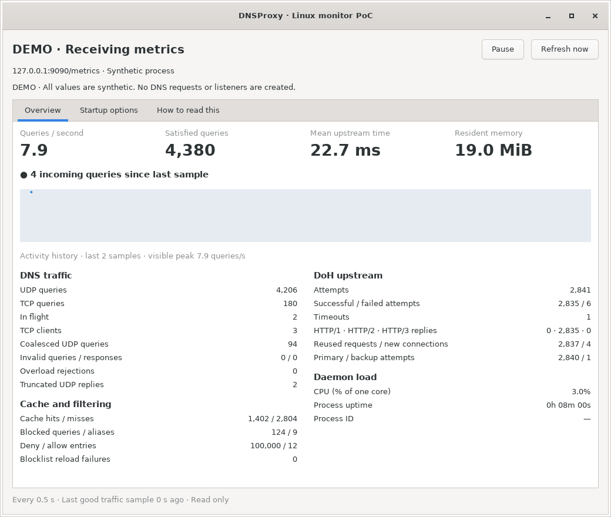

# Linux desktop monitor

This source tree includes an optional **read-only GTK 4 monitor** for `dnsp-modern`.
It helps explain a running resolver's configuration and activity. The C resolver
keeps its existing event loop and dependencies. The optional desktop package is
separate from the daemon package. GTK and Python are
needed only on machines where you choose to open the monitor.

GTK 4 is a native Linux toolkit with X11 and Wayland backends; Python uses its
PyGObject bindings. There is no browser, embedded web server, Electron runtime,
privileged helper or second implementation of DNS/DoH. This GTK monitor currently
supports Linux. Windows console launchers and service controls are documented in
the [Windows guide](WINDOWS.md).

## Preview

These are actual Linux CI screenshots in demo mode; all displayed values are
synthetic. Live integration tests separately exercise the running C resolver.




## Install the optional package

Download the `dnsp-modern-gui` package for your distribution from v4.6.0 or
later, or use the artifacts from a successful GitHub Actions build.
The Python GUI package is architecture independent: `all` for DEB or `noarch`
for RPM, tested on x86-64 and ARM64.

```sh
sudo apt install ./dnsp-modern-gui_*_all.deb    # Debian/Ubuntu
# Or on Rocky Linux 9:
sudo dnf install ./dnsp-modern-gui-*.noarch.rpm
dnsp-gui
```

Choose **DNSProxy Monitor** in the desktop application menu. It opens as your
ordinary desktop user. The package recommends the daemon, but also works with
a source-built daemon; use `--no-install-recommends` (APT) or
`--setopt=install_weak_deps=False` (DNF) when installing only the monitor.
Uninstalling the monitor leaves the running resolver alone. The daemon's
package has no GTK dependency. `dnsp-gui --demo` opens synthetic demo data.

## Try from a source checkout

Run the following commands from a source checkout containing `tools/linux-gui/`.
On Debian or Ubuntu, install the optional desktop dependencies:

```sh
sudo apt install python3-gi python3-gi-cairo gir1.2-gtk-4.0
/usr/bin/python3 tools/linux-gui/dnsp-gui.py --demo
```

The demo is explicitly labelled and generates synthetic values in memory. It
does not start a resolver, send queries, download lists or open a listener.
Use the system Python (`/usr/bin/python3`) so it can find the distribution's
GTK bindings. A Python virtual environment normally cannot see those packages.

For Fedora, the corresponding runtime packages are `python3-gobject` and `gtk4`.
GTK chooses the desktop's available backend. To request X11 explicitly:

```sh
GDK_BACKEND=x11 /usr/bin/python3 tools/linux-gui/dnsp-gui.py --demo
```

## Monitor a real resolver

For a source build, run DNSProxy in one terminal:

```sh
make dnsp-modern
./dnsp-modern -l 127.0.0.1 -p 5300 -m 9090 \
  -s https://cloudflare-dns.com/dns-query --cache-entries 256
```

In a second terminal:

```sh
/usr/bin/python3 tools/linux-gui/dnsp-gui.py &
# Send a query to exercise the activity indicator:
dig @127.0.0.1 -p 5300 example.org A
```

The GUI automatically detects a single readable `dnsp-modern` process. For
several instances, choose a PID in the window's **Resolver instance** selector,
or select one at startup:

```sh
/usr/bin/python3 tools/linux-gui/dnsp-gui.py --pid 1234 --interval 2
```

Replace `1234` with the desired PID. The GUI runs as your ordinary desktop user,
including when the resolver is a system service. If `/proc` access is restricted,
use traffic-only monitoring:

```sh
/usr/bin/python3 tools/linux-gui/dnsp-gui.py --metrics-port 9090
```

This connects only to the literal loopback address `127.0.0.1`, without HTTP
proxies or redirect following. Startup settings, PID, uptime and resource use
are unavailable in traffic-only mode. With both `--pid` and `--metrics-port`, the
port must match that process's `-m` argument to avoid displaying another
instance's statistics as its own.

If the daemon has no `-m` listener, the GUI can still show its startup settings,
uptime, CPU and resident memory. It explains that live traffic is unavailable;
it does not reconfigure or restart the service. For a packaged service, add `-m`
through the package's existing configuration procedure and restart it separately.
Do not run the GUI with `sudo` or change the system DNS settings just to try it.

## What the interface shows

| Area | Information |
| --- | --- |
| Overview | Query rate and bounded activity history; satisfied UDP/TCP query counts, active work and clients, coalescing, overload and truncation counters |
| DoH upstream | Completed attempts, failures/timeouts, lifetime mean attempt duration, connection reuse, primary/backup attempts, actual HTTP/1/2/3 reply counters |
| Cache and filtering | Cache hits/misses, blocked queries/aliases, loaded deny/allow entries and failed reloads |
| Daemon load | Process CPU as a percentage of one core, resident memory, uptime, PID, running daemon/libcurl versions and built HTTP/2/3 support |
| Service | Read-only `systemctl show dnsp-modern.service` state, including failed/missing/unavailable states and whether the unit owns a different PID |
| Latency | Estimated client-reply and completed-upstream-attempt p50/p95/p99 over the last 60 sampling intervals |
| Startup options | Disabled On/Off radio pairs and an invocation table showing explicit values versus defaults |
| How to read this | Counter meanings, limitations and troubleshooting |

Network configuration appears in **Startup options**: listen addresses, DNS and
metrics ports, upstream URLs, bootstrap addresses, transport preference,
connection limits, deadlines and UDP reply cap. The schema also covers cache,
EDNS padding, blocklists, allowlists and delayed parallel upstream requests. Repeated listen addresses and list files
are preserved. User information and URL query strings are redacted from upstream
URL displays. Unknown arguments trigger a warning without displaying their values.

These controls **represent** the invocation. They do not edit it. Omitted flags
are labelled as the current C defaults, rather than claimed to be runtime
introspection of a different daemon version. CI checks schema coverage and key
defaults against the current C source. Future CLI changes need corresponding
schema updates.

The query indicator updates after the next sample, not for each packet. With
**Pause**, the monitor reads data only when you press **Refresh now**. This is
the monitor's on-demand mode. It does not start the daemon or open a window when a
query arrives. Query-triggered daemon startup would need separate service/socket
activation design, especially for UDP and privileged port 53.

## Behaviour and limits

- Default refresh: one second; `--interval` accepts 0.5–30 seconds. Automatic
  collection stops while paused or while the window is unmapped. Closing the
  window leaves DNSProxy running.
- One background collector at a time keeps HTTP I/O off the GTK main loop. HTTP
  socket timeout is one second; responses are limited to 64 KiB and 512 samples.
  There is no pending-work backlog. Chart history is capped at 60 samples.
- Missing metrics are dashes. Connection loss clears traffic values and marks
  them unavailable; old history remains visibly separate from current data.
  Reconnecting, changing process identity, or a counter reset starts a new rate
  baseline. Pause/resume also resets the baseline.
- A selected PID is checked against its executable and kernel start time. A
  reused PID requires **Reconnect**, or choosing the new process explicitly. Automatic selection
  reconnects after a restart when a single readable resolver exists. Without a
  PID, resets can only be detected through falling counters.
- CPU may exceed 100% when several cores are busy. The daemon's CPU/RSS are
  displayed, not the GUI's. A measured monitor-overhead
  benchmark remains a follow-up.
- Upstream preference and negotiated protocol are different. `prefer-h3` can
  fall back; reply counters show actual use. `dnsp_build_info` exposes
  the running daemon version, numeric libcurl version and built HTTP/2/3 support.
  Older daemons without these metrics show dashes. Startup defaults remain
  schema defaults, not a claim that an older binary has identical defaults.
- Satisfied queries count complete `NOERROR` or `NXDOMAIN` responses written to
  client sockets. Truncated replies, other DNS errors and locally synthesized
  policy blocks are excluded.
  Upstream attempts can differ from client query counts because of caching,
  coalescing and failover. The displayed upstream mean includes failed completed
  attempts and is a lifetime mean. Recent percentiles interpolate bounded
  cumulative histogram deltas; they are estimates, not exact timings. Client
  observations cover fully written replies (including cache hits, policy blocks
  and DNS errors). Upstream observations cover completed attempts, including
  failures; cancelled losers are excluded. An idle window has no new latency
  observations. Above-range observations are labelled rather than clamped.
- The instance picker and service state refresh every five seconds. The fixed
  systemctl status command has a 750 ms timeout and never invokes service controls.
  Histogram history stores at most 61 compact samples. Selection changes, counter
  resets, disconnects and pause/resume clear latency and rate baselines.
- Interface bandwidth, wire byte counts, client names and queried domains are
  not exposed or collected. This monitor performs no packet capture and keeps
  no query log, persistent history or telemetry.

## Validation and follow-ups

Focused local checks exercise argument handling, real metrics HTTP responses,
limits, restarts, process identity, rates and the actual C resolver. The
**DNSProxy Linux desktop monitor** GitHub workflow runs these plus GTK tests under Xvfb
on **Ubuntu 22.04 x86-64** and **Ubuntu 24.04 ARM64**. It checks formatting and
imports, confirms queries appear in the GUI and that closing it leaves the
resolver running, and publishes source bundles and screenshots as CI artifacts.
The Xvfb tests cover X11; native Wayland validation remains a follow-up.

```sh
make dnsp-modern
/usr/bin/python3 tests/test_gui_monitor.py
# Optional desktop CI equivalents (also require xvfb, dbus-x11 and imagemagick):
dbus-run-session -- xvfb-run -a -s '-screen 0 1280x960x24' \
  /usr/bin/python3 tests/test_gui_gtk.py
```

The monitor is a troubleshooting companion. GitHub CI validates installation,
imports, launcher and desktop metadata on both CPU architectures, exercises
switching between two live resolvers, and publishes GTK screenshots. Native
Wayland tests and a measured monitor-overhead comparison remain useful follow-ups.
Editing configuration or controlling a system service needs a separate design
with authorization and validation.
