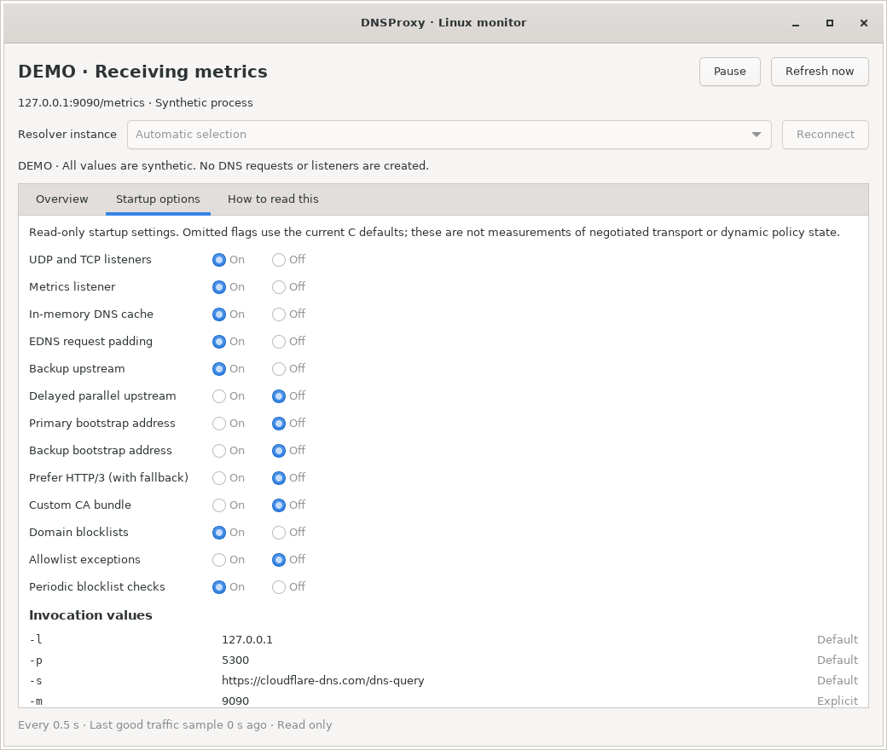

# Linux desktop monitor and resolver controls

This source tree includes an optional **GTK 4 monitor and ordinary-user launcher**
for `dnsp-modern`. It displays a running resolver's configuration and activity.
The desktop package is separate from the daemon package; GTK and Python are
required only for the desktop interface.

On Linux, GTK 4 supports X11 and Wayland, and Python uses its PyGObject bindings.
The shared desktop source also supports Windows and macOS. It runs as an
ordinary user, reads aggregate metrics, and controls only a resolver it started
itself. System service and adapter DNS configuration remain separate.
See the [shared desktop guide](DESKTOP-GUI.md) for Windows GUI installers,
the Homebrew Mac launcher and cross-platform behavior. This guide describes the
current source tree and CI artifacts. Release 4.9.0 contains the earlier Linux
interface; its assets do not include Windows GUI installers or the Mac GUI launcher.

## Preview

The screenshot below shows the earlier Linux interface during a GTK regression
with a real local resolver and 25 controlled DNS queries, including five NXDOMAIN
replies. Its timestamps and rates are observed samples from a local DoH fixture.


The startup-options screenshot shows the earlier interface with labelled
synthetic demo data:



## Install the optional package

Download the `dnsp-modern-gui` package for your distribution from v4.6.0 or
later, or use the artifacts from a successful GitHub Actions build.
The Python GUI package is architecture independent: `all` for DEB or `noarch`
for RPM, tested on x86-64 and ARM64.

```sh
sudo apt install ./dnsp-modern-gui_*_all.deb    # Debian/Ubuntu
# Or on Rocky Linux 9:
sudo dnf install ./dnsp-modern-gui-*.noarch.rpm
dnsp-gui
```

Choose **DNSProxy Monitor** in the desktop application menu. It opens as your
ordinary desktop user. The package recommends the daemon, but also works with
a source-built daemon; use `--no-install-recommends` (APT) or
`--setopt=install_weak_deps=False` (DNF) when installing only the monitor.
Uninstalling the monitor does not stop an independently running resolver or service.
Closing a GUI window stops only the resolver owned by that window. The daemon's
package has no GTK dependency. `dnsp-gui --demo` opens synthetic demo data.

## Try from a source checkout

Run the following commands from a source checkout containing `tools/desktop-gui/`.
On Debian or Ubuntu, install the optional desktop dependencies:

```sh
sudo apt install python3-gi python3-gi-cairo gir1.2-gtk-4.0
/usr/bin/python3 tools/desktop-gui/dnsp-gui.py --demo
```

The demo is explicitly labelled and generates synthetic values in memory. It
does not start a resolver, send queries, download lists or open a listener.
Use the system Python (`/usr/bin/python3`) so it can find the distribution's
GTK bindings. A Python virtual environment normally cannot see those packages.
The `tools/linux-gui/dnsp-gui.py` path remains a compatibility launcher
for the shared source; installed Linux packages still provide `dnsp-gui`.

For Fedora, the corresponding runtime packages are `python3-gobject` and `gtk4`.
GTK chooses the desktop's available backend. To request X11 explicitly:

```sh
GDK_BACKEND=x11 /usr/bin/python3 tools/desktop-gui/dnsp-gui.py --demo
```

## Monitor a real resolver

For a source build, run DNSProxy in one terminal:

```sh
make dnsp-modern
./dnsp-modern -l 127.0.0.1 -p 5300 -m 9090 \
  -s https://cloudflare-dns.com/dns-query --cache-entries 256
```

In a second terminal:

```sh
/usr/bin/python3 tools/desktop-gui/dnsp-gui.py &
# Send a query to exercise the activity indicator:
dig @127.0.0.1 -p 5300 example.org A
```

The GUI automatically detects a single readable `dnsp-modern` process. For
several instances, choose a PID in the window's **Resolver instance** selector,
or select one at startup:

```sh
/usr/bin/python3 tools/desktop-gui/dnsp-gui.py --pid 1234 --interval 2
```

Replace `1234` with the desired PID. The GUI runs as your ordinary desktop user,
including when the resolver is a system service. If `/proc` access is restricted,
use traffic-only monitoring:

```sh
/usr/bin/python3 tools/desktop-gui/dnsp-gui.py --metrics-port 9090
```

This connects only to the literal loopback address `127.0.0.1`, without HTTP
proxies or redirect following. Startup settings, PID, uptime and resource use
are unavailable in traffic-only mode. With both `--pid` and `--metrics-port`, the
port must match that process's `-m` argument to avoid displaying another
instance's statistics as its own.
The connection panel also accepts a **Local metrics port**. **Connect** observes
that endpoint; **Disconnect** stops monitoring it without stopping the resolver.

If the daemon has no `-m` listener, the GUI can still show its startup settings,
uptime, CPU and resident memory. It explains that live traffic is unavailable;
it does not reconfigure or restart the service. For a packaged service, add `-m`
through the package's existing configuration procedure and restart it separately.
Do not run the GUI with `sudo` or change the system DNS settings just to try it.

## What the interface shows

| Area | Information |
| --- | --- |
| Overview | Query rate, peak sampled QPS and bounded query/latency histories; query plot selects all traffic, UDP or TCP, and latency selects client-reply or completed-upstream p95 |
| DoH upstream | Completed attempts, failures/timeouts and failure ratio, lifetime mean and maximum attempt duration, connection reuse ratio, primary/backup attempts, actual HTTP/1/2/3 reply counters |
| Cache and filtering | Cache hits/misses, blocked queries/aliases, loaded deny/allow entries and failed reloads |
| Daemon load | Process CPU as a percentage of one core, resident memory, sampled CPU/memory/inflight peaks, missed traffic samples, uptime, PID, running daemon/libcurl versions and built HTTP/2/3 support |
| Service | Read-only `systemctl show dnsp-modern.service` state, including failed/missing/unavailable states and whether the unit owns a different PID |
| Latency | Estimated client-reply and completed-upstream-attempt p50/p95/p99 over the last 60 sampling intervals |
| Startup options | Disabled On/Off radio pairs and an invocation table showing explicit values versus defaults |
| Preferences | Live refresh interval, socket timeout, bounded history size, automatic refresh and chart visibility |
| Resolver options | Grouped local-listener, DoH-upstream and cache/filtering settings with file selection and validation for the next GUI-owned run |
| Launch resolver | Redacted CLI preview and start/stop of a separate unprivileged resolver |
| Diagnostics | Bounded, selectable, URL-redacted output and startup/exit errors from the GUI-owned resolver |
| How to read this | Counter meanings, limitations and troubleshooting |

Network configuration appears in **Startup options**: listen addresses, DNS and
metrics ports, upstream URLs, bootstrap addresses, transport preference,
connection limits, deadlines and UDP reply cap. The schema also covers cache,
EDNS padding, blocklists, allowlists and delayed parallel upstream requests. Repeated listen addresses and list files
are preserved. User information and URL query strings are redacted from upstream
URL displays. Unknown arguments trigger a warning without displaying their values.

The **Startup options** controls represent the monitored invocation. They do not
edit it. **Resolver options…** opens a grouped editor for a new ordinary-user
process; invalid edits leave the current configuration intact. Leaving a redacted
upstream URL unchanged preserves its complete saved value. Omitted flags
are labelled as defaults from the current C source. They are not values read
from the running process. CI checks schema coverage and key defaults against
the current C source.

The query indicator updates once per sample. With **Pause**, the monitor reads
data only when **Refresh now** is selected.

## Configure monitoring in the window

The **Preferences** tab applies changes immediately. Automatic refresh is a
checkbox synchronized with Pause/Resume. Refresh now remains available while
paused. Hide the chart to avoid chart redraws while continuing to collect counters.
The CLI provides the same initial settings:

```sh
dnsp-gui --interval 0.5 --timeout 2 --history 120 --no-chart
# Start paused and request a sample only when needed:
dnsp-gui --paused
```

`--timeout` accepts 0.2–5 seconds per socket operation; `--history` accepts
20–300 chart samples. The histogram percentile window stays at 60 sampling
intervals. Refresh intervals are measured using actual elapsed time, so changing
them does not invent QPS spikes. Peak QPS is the maximum **sampled interval
average**, not an instantaneous per-packet peak. CPU, memory and inflight peaks
are likewise sampled and reset when selecting a different resolver or observing
a restart/counter reset. Exact maximum upstream-attempt and UDP/TCP-client reply
durations are exported by the daemon since startup. Completed failed upstream
attempts are included; cancelled losing parallel attempts are excluded.
Older daemons without maximum gauges show dashes. Cache hit and failed-attempt
ratios use hits/(hits+misses) and failures/(successes+failures); reuse is reused
attempts/completed attempts. Zero denominators show dashes.

## Configure and launch a resolver

**Resolver options…** prepares a new invocation. Checkboxes enable metrics, cache,
EDNS padding, HTTP/3 preference, backup upstream, delayed parallel requests and a
blocklist. Fields select the executable, literal listen/bootstrap addresses,
DNS/metrics ports, URLs, cache capacity, backup delay, blocklist and optional CA
file. The executable, blocklist and CA fields have file pickers. If changing
upstream, update or clear its bootstrap address as well. **Validate and apply**
saves valid settings for the next owned run. **Preview command** validates the
draft and displays a command with URL credentials/query values hidden.
Start resolver uses the same argument list directly, with no shell. Demo mode
allows preview but disables launching.

The form defaults to loopback, DNS port 5300, metrics port 9090 and a 256-entry
cache. It runs as your desktop user and accepts ports 1024–65535. It never edits
an existing resolver/service, elevates privileges or changes system DNS. An
occupied port or unsupported feature causes the new daemon to exit; its exit
status and recent output appear in **Diagnostics**, including when the GUI was
opened from the desktop menu. The in-memory log is limited to 64 KiB, with URL
credentials/query values redacted. Stop launched resolver sends SIGTERM only
to the child started by this window, even if you subsequently monitor another
instance. Closing the GUI also stops and reaps that owned child, with a bounded
forced-termination fallback reported explicitly. Independently started resolvers
and services remain running. Use existing systemd configuration procedures for the packaged
system resolver or privileged port 53; those remain separate from this launcher.

## Behaviour and limits

- Default refresh: 0.5 seconds; `--interval` accepts 0.25–30 seconds. Automatic
  collection stops while paused or while the window is unmapped. Closing the
  window stops only its GUI-owned resolver; observed external processes and
  services remain running.
- One background collector at a time keeps HTTP I/O off the GTK main loop. HTTP
  socket timeout defaults to one second and is configurable from 0.2 to 5 seconds;
  responses are limited to 64 KiB and 512 samples. There is no pending-work backlog.
  Chart history defaults to 60 samples and is bounded by the selected 20–300 limit.
- A failed or delayed scrape retains the complete last valid frame, startup
  settings and activity chart. **No fresh data** and the last-good-sample age
  clearly mark stale statistics. Missed scrapes never insert false zeros into
  the chart. Reconnection starts a new rate/percentile baseline; the last rate
  stays visible with a baseline message until a new interval can be measured.
  Selecting a different instance, a confirmed process restart or counter reset
  clears that instance's frame and peaks. Pause/resume resets rate baselines.
- Successful snapshots are assembled before updating widgets. Unchanged labels
  are left alone; the interface never clears a frame before filling it. Completed
  worker samples are delivered directly to GTK's main loop. Only one worker can
  run, with no queued backlog, including while a scrape stalls.
- A selected PID is checked against its executable and kernel start time. A
  reused PID requires **Reconnect**, or choosing the new process explicitly. Automatic selection
  reconnects after a restart when a single readable resolver exists. Without a
  PID, resets can only be detected through falling counters.
- CPU may exceed 100% when several cores are busy. The displayed CPU and resident
  memory measurements belong to the daemon. Monitor overhead is not quantified
  by the functional regression suite.
- Upstream preference and negotiated protocol are different. `prefer-h3` can
  fall back; reply counters show actual use. `dnsp_build_info` exposes
  the running daemon version, numeric libcurl version and built HTTP/2/3 support.
  Older daemons without these metrics show dashes. Startup defaults remain
  schema defaults, not a claim that an older binary has identical defaults.
- Satisfied queries count complete `NOERROR` or `NXDOMAIN` responses written to
  client sockets. Truncated replies, other DNS errors and locally synthesized
  policy blocks are excluded.
  Upstream attempts can differ from client query counts because of caching,
  coalescing and failover. The displayed upstream mean includes failed completed
  attempts and is a lifetime mean. Recent percentiles interpolate bounded
  cumulative histogram deltas; they are estimates, not exact timings. Client
  observations cover fully written replies (including cache hits, policy blocks
  and DNS errors). Upstream observations cover completed attempts, including
  failures; cancelled losers are excluded. An idle window has no new latency
  observations. Above-range observations are labelled rather than clamped.
- The GUI reads `/metrics`, not `/live`. The diagnostic HTTP listener shares the
  C event loop with DNS and libcurl; UDP receive work is bounded per turn. Under
  saturation a scrape can still miss its socket deadline. A responsive GUI does
  not imply fresh resolver data, so freshness is always shown separately.
- The instance picker and service state refresh every five seconds. The fixed
  systemctl status command has a 750 ms timeout and never invokes service controls.
  Histogram history stores at most 61 compact samples. Selection changes, counter
  resets, disconnects and pause/resume clear latency and rate baselines without
  erasing the retained frame on a transient disconnect.
- The traffic collector uses aggregate metrics; interface bandwidth, wire byte
  counts, client names and queried domains are not exposed by that endpoint.
  The GUI performs no packet capture. It keeps bounded in-memory diagnostics
  from its own resolver, with no persistent query history or telemetry.

## Validation scope

`tests/gui-queries-25.txt` is an original, small query list in the same `NAME TYPE`
format used by [DNS-OARC's dnsperf/resperf sample data](https://github.com/DNS-OARC/sample-query-data).
The GUI regression sends it **once**, sequentially, at no more than 12.5 QPS,
with five controlled NXDOMAIN replies among 20 successful A/AAAA/TXT/MX/NS/SOA
replies. It observes the real GTK labels throughout the run, checks that ordinary
NXDOMAIN replies count as satisfied queries, and rejects disappearing numeric
values or missing scrapes under this modest workload. Separate tests cover a
48-query NXDOMAIN burst and genuine HTTP timeouts/recovery.

All names in the small list are reserved `.test`/`.invalid` names, and CI supplies
answers through a local DoH fixture. The DNS-OARC lists are query inputs, not an
expected-answer oracle: live answers can change. The large external corpus is
not downloaded by CI. Against public upstreams the reserved names can all return
NXDOMAIN; controlled positive answers exist only in the test fixture.


Focused local checks exercise argument handling, real metrics HTTP responses,
limits, restarts, process identity, rates and the actual C resolver. The
**DNSProxy Linux desktop monitor** GitHub workflow runs these plus GTK tests under Xvfb
on **Ubuntu 22.04 x86-64** and **Ubuntu 24.04 ARM64**. It checks formatting and
imports, confirms queries appear in the GUI, and distinguishes externally
started resolvers from GUI-owned children when closing a window. External
processes remain running; owned children are stopped and reaped. It publishes
source bundles and screenshots as CI artifacts. Additional native desktop tests
exercise the shared interface on Windows, Intel Mac and Apple Silicon.
The Xvfb tests cover X11. Native Wayland behavior is not covered by this workflow.

```sh
make dnsp-modern
/usr/bin/python3 tests/test_gui_monitor.py
# Optional desktop CI equivalents (also require xvfb, dbus-x11 and imagemagick):
dbus-run-session -- xvfb-run -a -s '-screen 0 1280x960x24' \
  /usr/bin/python3 tests/test_gui_gtk.py
```

GitHub CI validates installation, imports, launcher and desktop metadata on both
CPU architectures, exercises
switching between two live resolvers, and publishes GTK screenshots. Native
Wayland behavior and monitor overhead are outside this functional test coverage.
Editing system service configuration and privileged service controls remain
separate from the ordinary-user launch form.


### Activity chart and panel layout

The query and latency plots sit side by side on a wide desktop and stack on a
compact window. The query plot scales its height with the available width
(160–240 pixels), with a labelled rate axis, elapsed-time axis and a lightly shaded trace. The
newest observed sample sits at the right edge. Early samples use the available
plot width rather than occupying a tiny strip while history fills. The scale
has headroom above the visible peak; a missing sample remains a gap. A paused
or stale monitor retains its real data without inventing intermediate points.
The caption shows how many samples and seconds are actually recorded.

Sampling defaults to twice per second. Select 0.25 seconds in Preferences or
use `dnsp-gui --interval 0.25` for four updates per second when collection is
fast enough. There is still one collector at a time, with no queued backlog;
slow reads keep their existing deadline and stale-data indication.

The connection controls, both plots and information sections use matching
panel borders, padding and gutters. DNS traffic and upstream statistics share
an aligned row; cache/filtering and daemon load share the next row. Metric
cards retain equal widths and tabular numbers. Panels and plot labels use the GTK
foreground color to support light and dark themes.
