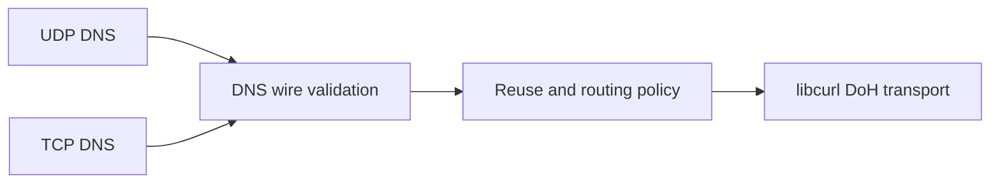

# dnsp-modern in Rust

A DNSProxy proof of concept aligned with the C implementation at revision [343323e4](https://github.com/fantuz/DNSProxy/commit/343323e411488cfa3e608dfbf8496de8d91959b8). The Rust executable accepts classic IPv4 DNS over UDP and TCP, then forwards binary DNS messages to upstream DNS over HTTPS. It uses the same libcurl HTTP/TLS/QUIC engine as the reference C binary.

[](https://github.com/fantuz/DNSProxy/actions/workflows/dnsp-rust-poc.yml)

The refresh includes compression checks that protect TTL rewriting, validation of legacy DNS name-bearing record formats, and destination-aware UDP replies for wildcard listeners. Coalesced queries and cache hits preserve each client's original destination address. `--version` reports the source version and build/runtime libcurl capabilities, and rate-limited failure logs identify the upstream role and CONNECT status.

## How the port is organized



1. `wire.rs` validates DNS envelopes, names and compression, EDNS, and upstream responses. It generates local errors and truncated UDP responses and applies TTL aging and optional EDNS padding.
2. `client.rs` implements TCP framing and backpressure. Each client may have one active query and one buffered successor. Replies stay ordered and the socket owns the lifetime of its pending transfer.
3. `proxy.rs` owns the bounded poll loop, the cache and coalescing policy, and the shared failover deadline. It handles metrics clients separately from DNS clients.
4. `doh.rs` configures libcurl's socket and timer callbacks, multiplexing and connection reuse. Reset easy handles return to a 16-entry pool. The original POST buffers and immutable header and bootstrap lists stay alive until libcurl releases them. `native.rs` contains the Linux and libcurl FFI boundary.
5. `cache.rs`, `config.rs` and `metrics.rs` preserve the optional TTL cache, startup controls, Prometheus output and on-demand SIGUSR1 report.

See [PORT_CHECKLIST.md](PORT_CHECKLIST.md) for the mapping from C functions to Rust and the checks for each area.

## Protocol behavior

| Area | Implemented behavior |
| --- | --- |
| DNS message limits | Up to 65,507 incoming UDP bytes on IPv4 and 65,535 bytes per TCP message or DoH response. Malformed messages are dropped or answered with a local DNS error according to the reference parser. |
| UDP reply limits | 512 bytes without EDNS. With EDNS, use the advertised size clamped to 512 through the configured cap. The default cap is 1,232 bytes and the configurable upper bound is 4,096. Oversize answers get a DNS TC response so the client can retry over TCP. |
| QTYPE and QCLASS | No A/AAAA allowlist for forwarding. A, AAAA, TXT, MX, HTTPS/SVCB, DNSSEC and unknown types can travel in the wire message. The port checks the envelope and known name-bearing RDATA while preserving opaque record data. |
| TCP | Two-byte length framing, reuse and ordered pipelining, separate frame-read and reply-write deadlines, FIN/RST handling and upstream cancellation. Default limits are 128 simultaneous TCP clients and 32 per source. |
| Upstream | Binary `application/dns-message` POST. `auto` negotiates HTTP/2 with HTTP/1.1 fallback. `prefer-h3` requires QUIC-capable libcurl 7.88 or later and permits TCP fallback to the same origin. HTTPS verification includes certificate and hostname checks. Plain HTTP is allowed on 127.0.0.1 for fixtures. |
| Backup routing | Eligible standard IN queries can retry on a distinct backup origin after a qualifying transport failure, within the original total deadline. DNS errors, HTTP errors and certificate failures are terminal. |
| Cache and coalescing | The optional cache covers eligible positive IN A/AAAA replies. It honors DNS TTL, DoH age and HTTP freshness, with a one-hour maximum lifetime. In-flight sharing covers a narrower set of unsigned UDP address queries and replays waiters separately when the response forbids reuse. |
| Signed traffic | TSIG and SIG(0) markers prevent TTL rewrites and proxy-added padding. The proxy forwards signed messages without local signature validation. |
| Scope | Single-exchange QUERY service. AXFR, IXFR and non-QUERY opcodes receive NOTIMP. The proxy delegates DNSSEC validation and recursive resolution to its upstream. |

The port follows the reference’s DNS wire, TCP framing, EDNS and DoH behavior, including Age subtraction and the 128-byte HTTPS request padding option. The inherited policy checks the wire exchange and leaves record-specific semantics to resolvers and clients. Relevant specifications are [RFC 1035](https://www.rfc-editor.org/rfc/rfc1035), [RFC 7766](https://www.rfc-editor.org/rfc/rfc7766), [RFC 6891](https://www.rfc-editor.org/rfc/rfc6891), [RFC 7830](https://www.rfc-editor.org/rfc/rfc7830), [RFC 8467](https://www.rfc-editor.org/rfc/rfc8467) and [RFC 8484](https://www.rfc-editor.org/rfc/rfc8484). libcurl supplies the [HTTP/2](https://www.rfc-editor.org/rfc/rfc9113) and [HTTP/3](https://www.rfc-editor.org/rfc/rfc9114) implementations.

The upstream POST retains the incoming DNS transaction ID and checks it on the reply, as the C proxy does. RFC 8484 recommends zero IDs to make HTTP caching more effective. The proxy also preserves signed messages on the full-response path. Locally constructed errors and TC replies have no message signature. [RFC 8484 §4.1](https://www.rfc-editor.org/rfc/rfc8484#section-4.1)

## Build and run

Run the commands below from the `rust-poc/` directory.

On Debian 13, install the C linker and system libcurl development package. Python and OpenSSL are for the local test fixtures. Install Rust with rustup and select 1.90.0 to reproduce the measured build. [Rust installation](https://rust-lang.org/tools/install/)

```sh
sudo apt-get install build-essential pkg-config libcurl4-openssl-dev \
  ca-certificates curl openssl python3 python3-venv
rustup toolchain install 1.90.0 --profile minimal --component rustfmt --component clippy
export RUSTUP_TOOLCHAIN=1.90.0
pkg-config --modversion libcurl
curl-config --features
cargo build --release --locked
ldd target/release/dnsp-modern-rust | grep libcurl
target/release/dnsp-modern-rust --help
```

Use `curl-config` from the same installation as the system libcurl selected by `pkg-config`. HTTP/3 tests require the linked library to advertise `HTTP3`. The runtime checks that feature at startup when `prefer-h3` is selected.

In one terminal, run the proxy. These manual examples use the default public DoH upstream.

```sh
target/release/dnsp-modern-rust -l 127.0.0.1 -p 5300 -m 9153 \
  --cache-entries 256 --edns-padding
```

In a second terminal, query both downstream transports and inspect the counters. `dig` is provided by `dnsutils` on Debian.

```sh
dig @127.0.0.1 -p 5300 example.com A +bufsize=1232
dig @127.0.0.1 -p 5300 example.com HTTPS +tcp
curl --noproxy '*' -fsS http://127.0.0.1:9153/metrics
```

Send `kill -USR1 PID` to the proxy process for a one-line status report on stderr. Use `--upstream-http=prefer-h3` to try HTTP/3 and check `dnsp_upstream_http_responses_total{version="3"}` to confirm actual negotiation.

## Repeat the checks

1. Build the Rust binary and create the Python fixture environment.

   ```sh
   python3 -m venv .venv
   .venv/bin/python -m pip install -r requirements-bench.txt
   PYTHON=.venv/bin/python scripts/check.sh
   ```

   Use `scripts/check.sh core` for the Rust checks and current C integration tests on a system without HTTP/3. The full script stages the inherited Python checks unchanged and adds a TLS probe for both IPv6 bootstrap options. Test upstreams, clients and certificates are local.

2. Check out and build the pinned C reference in a separate directory.

   ```sh
   git worktree add --detach ../../dnsp-modern-c "$(cat SOURCE_REVISION)"
   make -C ../../dnsp-modern-c -f modern.mk dnsp-modern CFLAGS='-O2 -g -Werror'
   ```

3. Run the direct DNS wire comparison. The same seed generates boundary cases, valid queries across types and classes, and mutated messages for both parsers. It compares parse outcomes and metadata, padding and aging fingerprints, and cache and failover eligibility.

   ```sh
   python3 tests/parity/run.py ../../dnsp-modern-c
   ```

4. Run the matched benchmark. The script alternates which binary runs first and saves JSON and CSV for each of three runs. It uses the original project’s loopback load generator with the same TLS fixtures and connection cap for both binaries.

   ```sh
   PYTHON=.venv/bin/python scripts/bench-compare.sh \
     ../../dnsp-modern-c/dnsp-modern ./local-bench-results
   ```

The delivered measurements come from local Linux loopback. The benchmark uses UDP on the downstream leg and records the HTTP version negotiated upstream. TCP correctness and lifecycle are covered by the tests.

## GitHub validation

Pushes to `rust-poc` run formatting, Clippy, Rust unit tests and the current C integration suite on Ubuntu 22.04 and 24.04 amd64 and Ubuntu 24.04 arm64. A Debian 13 job runs the full HTTP/2 and HTTP/3 fixtures, compares wire behavior against `SOURCE_REVISION`, and uploads three matched C/Rust benchmark runs as an Actions artifact. The jobs use Rust 1.90.0 and each platform's system libcurl.

The executable's first `--version` line uses the repository's `VERSION`; `implementation=rust-poc` identifies this implementation. The C package release workflow continues to build the C executable.

## Original feasibility measurements

The results below describe the original port against C revision `4417e285f914393bf3019d5eb075d05209f3f69c`. Current comparisons are available in the Rust workflow's benchmark artifacts.

- Release build, formatting and Clippy with warnings treated as errors passed.
- 9 Rust unit checks, 83 inherited Python checks and the additional IPv6 bootstrap check passed. The IPv6 probe passed against the pinned C binary too.
- 24,187 wire cases matched the C oracle. The default seed was 8484 and the corpus SHA-256 was `f0feec74c257ccddd9a77a08803f237b0677071fbc3a063686a83819d3507dfb`.

### Loopback benchmark

The host ran Debian 13 on amd64. Both proxies linked to system libcurl 8.14.1 with OpenSSL 3.5.7, HTTP/2 and HTTP/3. The C build used GCC 14.2.0 at `-O2`, and the Rust build used Cargo's release profile with thin LTO. The fixture ran on Python 3.12.14. Each level had 0.5 s warmup, 2 s measurement and a 1 ms upstream delay. The fixture returned one A record. Both proxies used the default per-host cap of 8, with the answer cache disabled.

Each row shows the median across three runs. RSS is the process high-water mark observed by the end of that level.

| Upstream | UDP clients | C QPS | Rust QPS | C p99 | Rust p99 | C peak RSS | Rust peak RSS |
| --- | ---: | ---: | ---: | ---: | ---: | ---: | ---: |
| HTTP/2 | 1 | 501 | 491 | 3.33 ms | 3.59 ms | 8.6 MiB | 9.0 MiB |
| HTTP/2 | 8 | 1,977 | 1,721 | 6.27 ms | 6.92 ms | 9.1 MiB | 9.4 MiB |
| HTTP/2 | 32 | 2,414 | 2,287 | 21.11 ms | 23.23 ms | 10.7 MiB | 11.1 MiB |
| HTTP/3 | 1 | 501 | 471 | 3.63 ms | 3.19 ms | 9.3 MiB | 9.6 MiB |
| HTTP/3 | 8 | 2,036 | 1,592 | 7.56 ms | 8.06 ms | 11.4 MiB | 11.6 MiB |
| HTTP/3 | 32 | 1,804 | 1,482 | 26.36 ms | 30.32 ms | 15.3 MiB | 14.9 MiB |

The C binary completed 54,819 measured replies and the Rust binary completed 50,154, with zero failures, timeouts or truncations in both sets. Every measurement used the requested HTTP version. The fixture observed one reused upstream connection per run and protocol, with concurrent streams at 8 and 32 clients.

At 32 clients, Rust throughput was 5.3% lower on HTTP/2 and 17.9% lower on HTTP/3. The HTTP/3 proxy used about one CPU core at that level in both builds. The proxy, mock upstream and load generator shared the same host. These short measurements characterize this fixture and leave the HTTP/3 throughput difference open for profiling.

The [results directory](results/) contains the six JSON and CSV result pairs, including negotiated protocol, upstream concurrency, timing phases and CPU/RSS samples.
